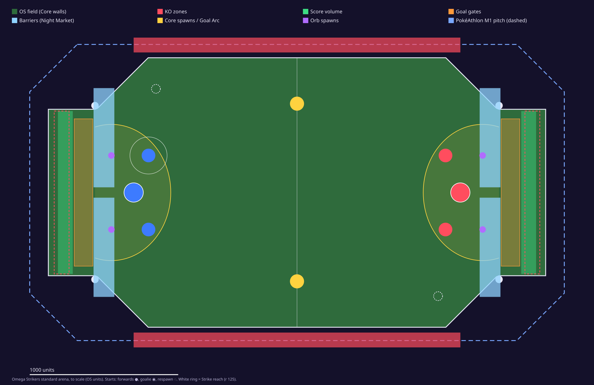

# Omega Strikers: stage logic, sizes and goal line (data-mined)

> Source: the game's own level and blueprint files (`base-game-assets.pak`), read with our scripts in
> `tools/research/` (`exports.py`, `layout.py`, `arena_svg.py`) on 2026-11-04.
> Values are OS world units (Unreal cm), the same scale our sim uses (player speed ≈ 450 u/s).
> **⚠ = our interpretation** of an unlabeled value or an actor's purpose. Positions and sizes are read
> directly; *what a volume does* is inferred from its name and placement.

## 1. How OS builds a stage

Each arena is **two levels stacked**:

| Layer | File | Contains | Varies per map? |
|---|---|---|---|
| **Frame** | `Maps/GameMap/GameMap<Name>.umap` | Core rebound walls, KO volumes, score volumes, goal gates, goal posts, Goal Arcs, court halves, camera bounds, invisible walls | **Almost never.** Every competitive map shares the same frame. Only Drums/Obscura split side walls for their gimmick, and Oni Village widens the Goal Arc |
| **Terrain** | `Maps/GameMap/CompetitiveTerrains/Map<Name>.umap` | Player starts, respawns, Core spawns, orb spawns, **goal barriers**, map obstacles/hazards | **Yes.** This is where a map gets its identity |

The gameplay actors are simple primitives (boxes, capsules, cylinders) whose base extent is **50** and
get scaled per placement. The visible art is a separate layer. **For us: a stage = shared frame + terrain JSON.**

### Actor glossary (internal names)
| Actor | Count | What it is |
|---|---|---|
| `RW_Box` | 12 | **Rebound walls**: what the Core bounces off |
| `KOV_Box` | 4 | KO-named volumes: two side strips + one inside each goal pocket ⚠ (exact role unclear, see `PDV_Box`) |
| `SV_Box` | 2 | **Score volumes**: the Core touching one = goal |
| `TP_GoalGateSpawnPoint` + `Terrain_MovingGoalWall` | 4 | **Goal gates** (two sliding halves per goal) |
| `Terrain_Cylinder` | 4 | **Goal posts** |
| `Terrain_Breakout_*` | 1–2 per side | **Goal barriers** (shape and position per map) |
| `GTV_GoalArc` | 2 | **Goal Arc** (defender buff zone) |
| `GTV_CourtVolume` | 2 | **Court halves** (own/enemy half, used by goalie gear and Awakenings) |
| `InvisibleWall_Box` | 24 | **Player movement walls** ⚠ (you can't *walk* off the arena) |
| `PDV_Box` | 16 | **Player death volumes** ⚠: they ring the *whole* arena just outside the walls (sides, corners, behind the goals). Together with the wiki ("knocked into any edge = KO"), this means **every edge KOs** |
| `CCV_Box` / `PABV_Box` | 2 / 6 | Camera constraint / play-area bounds ⚠ |
| `FOG_Semicircle` | 2 | "Face-off guard" semicircle at ±1200 ⚠ (kickoff exclusion zone) |
| `RockSpawn_Blueprint` | 2 | **Core spawn points** (OS calls the Core "Rock" internally) |
| `PlayerStart*` / `PlayerRespawn*` / `*OrbSpawn` | — | Starts, respawns, power-orb spawns |

## 2. The standard frame (all competitive maps)

Our axes from here on: **long axis = goal to goal** (OS Y), **side axis** (OS X). Origin at the centre.

| Feature | Value | Notes |
|---|---|---|
| **Field width** (Core side walls, inner face) | **±910** → 1,820 | `RW_Box7/8` at ±960, 50 thick |
| **Goal-mouth line** | **±1,360.5** → 2,721 mouth to mouth | goal posts sit on it |
| **Corner cuts** | diagonal from (1,002, 910) to (1,343, 569) | `RW_Box12–15`, 45°, length 485 |
| **Goal mouth** | **side ±562** → 1,124 wide (62 % of the field width) | channel walls `RW_Box11/16–18` |
| **Goal posts** | radius **25** at (±1,360.5, ±587) | `Terrain_Cylinder` r 50 × 0.5 |
| **Goal pocket** | from the mouth (1,360.5) to the back wall (**1,674.5**), 1,124 wide | `RW_Box19/20` |
| **Score volume** | long **1,510–1,610**, side ±550 | about **150 behind the mouth line** |
| **Goal gates** | long 1,375–1,500 (centre 1,437.5), side ±497.5, two sliding halves | gaps of ~65 at the sides are smaller than the Core (95), so closed gates block it |
| **Goal Arc** | ellipse centred at long ±1,250, radius **400** (long) × **460** (side) | Oni Village: 1.435 × wider |
| **Court halves** | side ±920, each half ~1,600 deep | own half / enemy half |
| **KO** | **any edge** for a knocked player: `PDV_Box` ring at side ≥925, corners, behind the pockets (long ≥1,525); `KOV` strips at side 946–1,046 (long ±1,100) and inside the pockets | corrected 2026-11-04 (first draft said sides only) |
| **Goal-pocket KO** | long 1,535–1,635, side ±550 | knocked *into* the goal = KO |
| **Player walls** ⚠ | sides at ±970 (inner face) for long ±1,000; walls beside the goal mouth, at the corners and at the back of the pocket (1,535) | They stop *walking*. Knocked players fly past them into the death volumes |

### Goal-line logic (how a goal happens)
1. The Core must break the **barriers** (terrain) in front of the goal.
2. Once all of a side's barriers are gone, the **gates** (two halves at 1,437.5, just behind the mouth) slide open.
3. The Core enters the **pocket** past the posts (mouth line 1,360.5).
4. It must keep travelling about **150 units** until it touches the **score volume** (front face 1,510; the Core counts once it overlaps, so its centre reaches ~1,462). That's room for **goal-line clearances**: a defender can still Strike it out inside the pocket.
5. The back wall (1,674.5) rebounds anything that doesn't score. A **KO volume** sits inside the pocket, so strikers knocked into the goal are KO'd.

## 3. Sizes

| Thing | Radius | Diameter | Source |
|---|---|---|---|
| **Core** | **47.5** | 95 | `Rock_Base` collision capsule (half-height 100) |
| Striker body (movement), Normal | **46** | 92 | `C_*` CollisionCylinder |
| Striker body, Large (X, Atlas, Asher) | **60** | 120 | |
| Striker body, Very Large (Dubu) | **65** | 130 | half-height 70 |
| Striker **hurtbox**, Normal | **55** | 110 | `Character_Base` HitCollisionCapsule (half-height 400) |
| Hurtbox, Large / Very Large | **70 / 75** | 140 / 150 | per-character override |
| **Strike reach** (wiki) | 125 / 132.5 / 135 | 250 / 265 / 270 | Normal / Large / Very Large |
| Goal post | 25 | 50 | |

**Proportions that define the feel:**
- **Core ≈ a Normal striker's body** (95 vs 92). The puck is as big as a player.
- **Strike reach ≈ 2.7 × body radius.** You hit the Core from more than a body-length away.
- **Field width ≈ 20 bodies, length ≈ 30 bodies.** With speed ~450 u/s you cross the width in ~4 s and the length in ~6 s.
- A Strike (~1,350 u/s, friction halving per second) travels about **1,950**, roughly **70 % of the field length**.
- Goal mouth = **12 Core diameters** wide, but closed by gates until the barriers fall.

## 4. Spawns per terrain

| | Night Market | Oni Village | Atlas Lab | Ahten City | Drums |
|---|---|---|---|---|---|
| Forwards | (±1,000, ±250) | (±910, ±300) | (±950, ±200/250) | (±1,000, ±250) | (±1,000, ±250) |
| Goalie | (±1,100, 0) | (±1,200, 0) | (±1,200, 0) | (±1,100, 0) | (±1,100, 0) |
| Respawn | (∓950, ±700) | 3 per team around (±1,000–1,150, ±500–650) | (∓950, ±700) | same | same |
| **Core spawn** | **(0, ±600)** | (0, ±600) | (0, ±600) | (0, ±600) | (0, ±650) |
| Orbs | mid (0, ±600) + goal (±1,250, ±250) | mid (0, ±600) + goal (±1,300, ±250) | same | mid (±550, ±700) + goal (±1,200, 0) | mid (0, ±700) + goal (±1,200, −450) |
| Barriers | 2/side: blocks ~670 long at (±1,300, ±370) | 2/side, angled at (±1,206, ±484) | 2/side: spheres (scale 3.5) at (±1,050, ±400) | **1/side**, big, at (±1,345, 0) | — (drums) |

The Core **doesn't spawn at dead centre**. It drops at midfield on one of the two side spots (0, ±600) with a
`RockSpawnIndicator`. ⚠ Which side is used each round isn't readable from the files; alternating or random are likely.

## 5. Gameplay stats confirmed from the files (current patch)

`GE_<Archetype>DefaultAttributes` holds the live base stats. They differ slightly from the wiki:

| Striker | Move speed | Stagger | Growth | Power |
|---|---|---|---|---|
| Kai (SpeedySkirmisher) | 475 | 1,150 | 250 | 90 |
| Juliette (FlexibleBrawler) | 460 | 1,300 | 425 | 110 |
| Dubu (StalwartProtector) | 435 | 1,500 | 500 | 100 |
| X (HulkingBeast) | 440 | 1,400 | 500 | 125 |
| Asher (Shieldz) | 440 | 1,400 | 500 | 120 |

All also carry 75 (Energy max) and two constants (32, 512) ⚠ unidentified.

## 6. PokéAthlon vs OS (current M1 values)

| | OS | PokéAthlon now | Recommendation |
|---|---|---|---|
| Field (long × side) | 2,721 × 1,820 (mouth to mouth) | 3,600 × 2,000 | **Adopt OS:** ±1,360.5 × ±910 |
| Corner cut | 341 × 358 diagonal | 320 | Adopt (1,002, 910) → (1,343, 569) |
| Goal | 1,124-wide pocket, score line 150 deep, back wall 1,674.5, posts r 25 | none (decorative) | Build the full pocket in M2 |
| Ball radius | **47.5** | 70 | **47.5** |
| Body radius N/L/VL | **46 / 60 / 65** | 60 / 72 / 85 | **Adopt** |
| Hurtbox N/L/VL | **55 / 70 / 75** | (same as body) | Add a separate hurtbox for abilities (M3) |
| Strike reach | 125 / 132.5 / 135 | 125 / 132.5 / 135 + 35 ball bonus | Keep. Base the reach check on the Core *centre* within reach + Core radius ⚠ |
| Player edge | walls stop walking; knocked past any edge = KO | slides along every edge | **Done in M2**: walking outline + KO when a knocked player's centre leaves it |
| Core spawn | side spots (0, ±600) | centre | Adopt |
| Starts | F (±1,000, ±250), G (±1,100, 0) | stage JSON placeholders | Adopt |
| Sprite scale | — | 5 units/px (Pikachu ≈ 160 tall) | Re-check after shrinking: bodies are 92 wide, so ~3.5–4 u/px |

**Proposal:** turn the stage JSON into **frame + terrain**, like OS. The frame is shared (walls as segments,
KO volumes, score volumes, gates, posts, Goal Arc). Each terrain lists spawns, barriers and hazards.
Adopt the OS sizes above at the start of M2, then re-tune camera zoom and sprite scale.

## 7. The visual layer (Ahten City, read 2026-11-05)

Read with `tools/research/pak.py` + `uasset.py` (name tables only; mesh and texture data not decoded).
`Maps/EnvironmentArt/Arenas/AhtenCity/`:

| Piece | File (LOD0 size) | What it is |
|---|---|---|
| `BP_Arena_VisualMaster` → `BP_Arena_<Map>_Master` | — | Spawns LOD0/LOD1/LOD2 children (quality levels). `BP_Arena_LODBase` has `ApplyTeamRotation`: the visuals turn 180° by `AssignedTeam`, so each player sees their own goal on the same side |
| `SM_..._Floor` | 120 KB | The playing surface |
| `SM_..._Decals` | 77 KB | Field markings, Goal Arc and barrier decals as a separate overlay mesh (decal atlas `T_Arena_6_Decals`) |
| `SM_..._Sides` | 1.16 MB | The rim and outer walls: most of the detail |
| `SM_..._Engines` + `_JetBlades` | 1.18 MB + 104 KB | The corner turbines (the arena is a flying platform); blades spin |
| `SM_..._Screens` | 16 KB | Big screens; animated material `M_Arena_Screens` with mask textures |
| `SM_..._Foliage` | 366 KB | Plants on the rim |
| `SM_..._Background` | **9.5 KB** | A few flat cards with one painted texture (`T_Arena_Background_02`, `M_Arena_Background`) plus an atmosphere layer |
| `SM_..._GoalBarrier` + VFX | 50 KB | The barriers and their glow |
| Commons | — | Goal gates mesh + glow, `M_Arena_EnergyWall` (goal pocket glass), still water, water foam |

**Materials:** `M_Arena_StampMap` (shared pattern sheet `T_S2_Default_Arena_Patterns` + baked ambient occlusion
`T_S2_Default_Arena_Platform_AO`), vertex-colour "stamp" variants, and unlit lightmapped variants.
So the look is mostly painted and baked, not lit in real time.

**Takeaway for us:** spend detail on the rim and the 4 corners (what the camera frames), keep the field clean, put
markings on a separate overlay, and make the far background a painted card. Offer quality levels.
